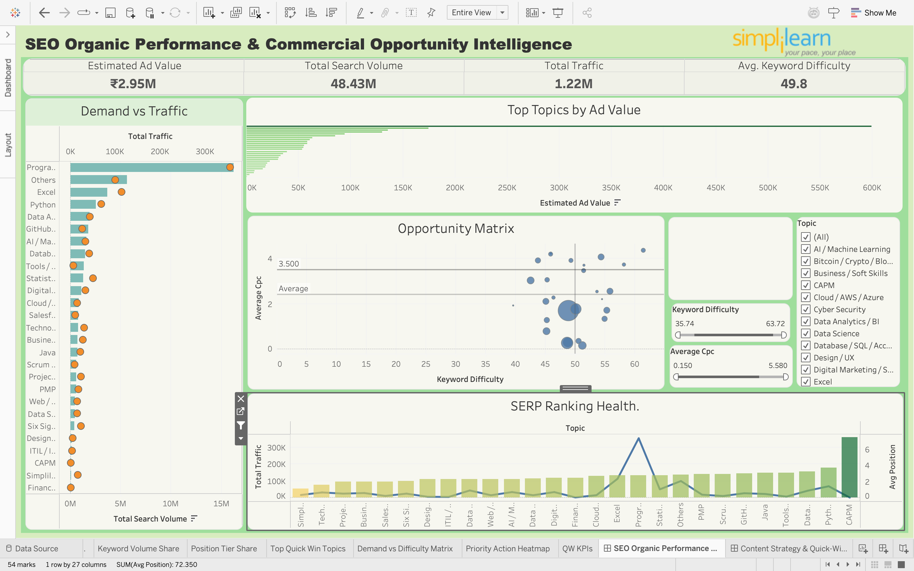
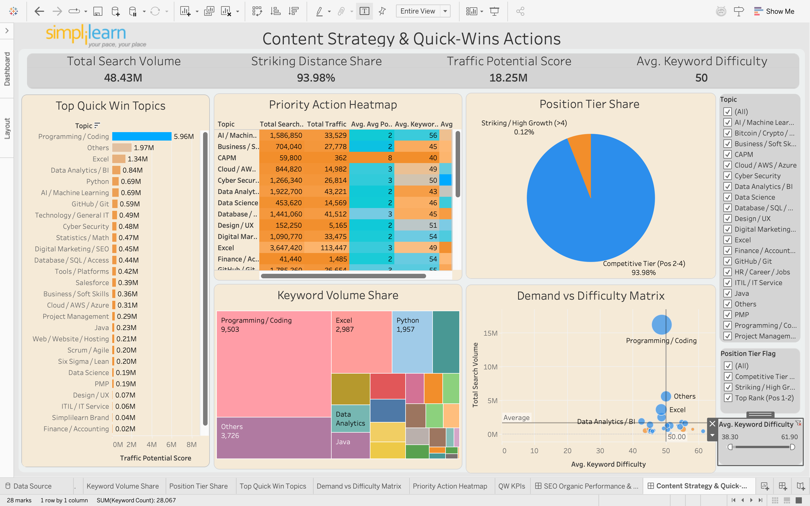
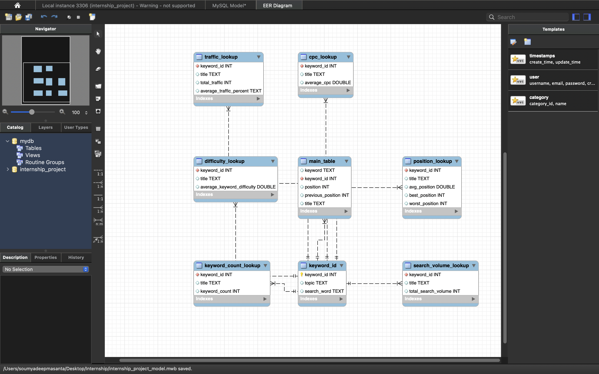

# SEO Organic Performance & Commercial Opportunity Intelligence

An end-to-end SEO analytics project that turns 30,000 organic-search keyword records into actionable content, traffic, and commercial-opportunity insights.

The project combines Python analysis, relational database design, and Tableau dashboards to identify high-value topic areas, evaluate ranking health, and prioritize quick-win opportunities.

## Dashboard previews

### Organic performance overview



### Content strategy and quick wins



## Project objectives

- Clean and prepare organic keyword-ranking data for analysis.
- Group individual keywords into topic-level categories.
- Measure search demand, traffic, ranking position, keyword difficulty, CPC, and estimated advertising value.
- Identify quick-win content opportunities from position tiers and traffic potential.
- Explore the relationship between search volume and traffic.
- Segment keywords with K-means clustering.
- Present insights through interactive Tableau dashboards.

## Dataset

The source workbook contains **30,000 keyword records** collected on **26 January 2025**. It includes:

- Keyword and assigned topic ID
- Current and previous Google ranking position
- Search volume and keyword difficulty
- Cost per click (CPC), traffic, traffic share, and traffic cost
- Competition and number of results
- Search-intent, SERP-feature, and position-type information

The data file also contains prepared MySQL-ready tables, including `main_table`, `keyword_id`, and lookup tables for search volume, traffic, CPC, difficulty, position, and keyword counts.

## Analysis workflow

1. **Data preparation** — removes exact duplicate records, trims text fields, fills missing values, converts timestamp values, parses trend arrays, and calculates position change.
2. **Exploratory analysis** — visualizes top-traffic keywords, traffic distribution, keyword intents, keyword difficulty, search volume, and position changes.
3. **Correlation analysis** — evaluates the relationship between search volume and traffic using Pearson and Spearman coefficients.
4. **Clustering** — standardizes search volume and traffic, evaluates candidate cluster counts with the elbow method, and applies K-means clustering with three clusters.
5. **Database modeling** — normalizes the analysis into topic, main, and lookup tables for MySQL.
6. **Dashboarding** — surfaces portfolio performance, demand-versus-difficulty, ranking tiers, topic priority, and quick-win actions in Tableau.

## Key results

- The notebook reduces the source from 30,000 to **29,991 distinct records** after removing exact duplicates.
- Search volume and traffic have a **moderate positive relationship**: Pearson *r* = **0.6235** and Spearman *ρ* = **0.4641**.
- The Tableau dashboards report roughly **48.43M total search volume**, **1.22M total traffic**, and **₹2.95M estimated ad value** across the analyzed portfolio.
- The quick-win dashboard identifies a **93.98% striking-distance share** in the competitive position tier (positions 2–4), helping prioritize content improvements close to top ranking.

## Repository structure

```text
.
├── assets/
│   ├── dashboard-performance.png
│   ├── dashboard-quick-wins.png
│   └── mysql-er-model.png
├── data/
│   └── organic_keyword_data.xls
├── database/
│   └── internship_project_model.mwb
├── notebooks/
│   └── seo_organic_performance_analysis.ipynb
└── tableau/
    └── seo_organic_performance_dashboard.twb
```

## Tools used

- **Python:** pandas, NumPy, Matplotlib, Seaborn, scikit-learn
- **SQL:** MySQL and MySQL Workbench
- **Business intelligence:** Tableau
- **Notebook environment:** Jupyter Notebook or Google Colab

## How to run the notebook

1. Clone this repository.
2. Install the Python packages:

   ```bash
   pip install pandas numpy matplotlib seaborn scikit-learn xlrd
   ```

3. Open `notebooks/seo_organic_performance_analysis.ipynb` in Jupyter Notebook or Google Colab.
4. In Google Colab, upload `data/organic_keyword_data.xls` when prompted. For a local Jupyter run, update the notebook's file path to point to that file.
5. Run the notebook cells in order.

## Tableau and MySQL notes

- The Tableau workbook was built against a local MySQL database named `internship_project` and includes an extracted data source. To refresh it against MySQL, recreate the tables from the supplied workbook/model and update the Tableau data connection for your environment.
- The MySQL Workbench file provides the database model; the ER diagram is included below for quick reference.



## Author

**Soumyadeep Masanta**  
GitHub: [@Soumyadeepmasanta](https://github.com/Soumyadeepmasanta)

## Data note

This repository is shared as a portfolio project for educational and analytical purposes. The source keyword data is a point-in-time export; metrics and rankings can change over time.
